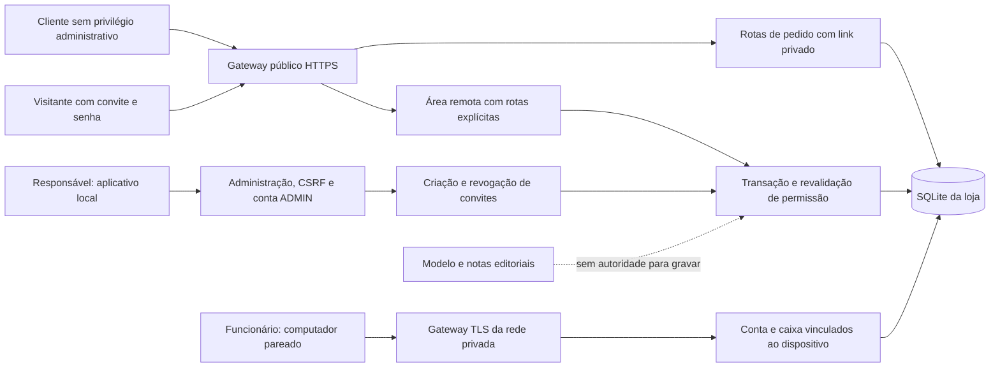

# Ameaças, fronteiras e decisões de segurança

Análise técnica do artefato, sem alegação de cobertura integral do OWASP ASVS. A autorização comercial reside no código e no banco, não em instruções de notas ou respostas do modelo.

| ID | Ativo e tentativa | Controle implementado e evidência selecionada | Risco residual |
| --- | --- | --- | --- |
| A01 | Visitante usa Host ou cabeçalho de proxy para atingir o painel. | Gateway com endpoints conhecidos, identidade externa e bloqueio de `/gestao`; `tests/test_publicacao.py::test_gateway_bloqueia_painel_mesmo_com_sessao_e_host_forjados`. | Vulnerabilidades em dependências, sistema operacional ou rotas futuras precisam de revisão. |
| A02 | Um convite remoto é reutilizado, tem senha adivinhada ou acessa outra conta. | Convite aleatório de uso único, senha da conta vinculada e limites de tentativas; `tests/test_acesso_remoto.py::test_link_so_aceita_conta_vinculada_e_uma_unica_entrada`, `test_limite_de_login_nao_confia_em_ip_forjado`. | Furto simultâneo de convite e senha ou comprometimento do dispositivo continua relevante. |
| A03 | Uma sessão revogada tenta alterar um pedido entre autenticação e gravação. | Revalidação dentro da transação e estado esperado; `tests/test_acesso_remoto.py::test_revogacao_antes_da_transacao_impede_pedido_e_aviso`, `test_consulta_nao_avanca_e_operacao_usa_status_esperado`. | Uma operação já confirmada ou resposta em trânsito não é desfeita pela revogação posterior. |
| A04 | Perfil de caixa ou área remota tenta obter credenciais, backups ou dados de outros caixas. | Gateways separados, sessão vinculada e DTOs remotos reduzidos; `tests/test_acesso_remoto.py::test_dados_remotos_minimizados_e_gestao_interna_bloqueada`, `tests/test_politica_terminal.py`. | Nomes e observações necessários ao atendimento continuam visíveis às contas autorizadas; orientar uso mínimo de dados. |
| A05 | Nota ou mensagem induz alteração de preço, vazamento ou confirmação inventada. | Operações determinísticas, seleção editorial e validação de links; `tests/test_respostas.py`, `tests/test_protecao_ia.py`. | Heurísticas e testes finitos não garantem bloqueio de toda injeção de prompt. |
| A06 | Uma instalação herda o token de outra pessoa ou troca de conta durante uma configuração. | Credenciais explícitas, relação app/token, seleção de número e transações; `tests/test_meta_configuracao.py::test_consulta_usa_credenciais_explicitamente_e_nunca_retoma_token_de_outra_pessoa`, `test_conta_alterada_durante_consulta_nao_e_sobrescrita`. | Configuração incorreta na Meta e revogação externa ainda podem interromper o serviço. |
| A07 | O responsável perde permissão no intervalo antes de criar um acesso remoto. | Revalidação de ADMIN ativo e versão da conta na transação; `tests/test_acesso_remoto.py::test_autorizacao_do_responsavel_revalidada_dentro_da_transacao`. | A conta Windows do responsável ou o administrador do dispositivo está fora da fronteira de proteção contra um host comprometido. |

As referências de teste identificam comportamentos verificáveis, não resultados atuais automáticos. Executar a versão escolhida. O ambiente da loja e os canais de compartilhamento de convites também precisam de controle do responsável.

## Decisões para justificar à banca

- **Gateway público e administração local:** evitar exposição integral do painel; a área remota possui contrato reduzido, convite, senha e validade.
- **Revalidação na transação:** reduzir a janela entre conferir permissão e gravar. A conferência do estado conhecido também evita dois avanços por clique repetido.
- **Hashes de convites e sessões:** não persistir os respectivos segredos em texto; isso não protege um navegador ou sistema operacional já comprometido.
- **Sessão com prazo e revogação:** reduzir persistência indevida. Reiniciar o aplicativo encerra convites, e uma nova entrada exige nova autorização local.
- **IA sem autoridade de persistência:** estilo e recuperação editorial podem variar sem tornar o texto gerado uma ordem para executar ações.
- **Provedor de mensagens separado:** credencial oficial Meta é configurada por instalação e pode ser revogada externamente. O adaptador LOCAL não deve ser apresentado como API oficial da Meta.
- **SQLite e valores monetários:** caixa usa centavos inteiros, enquanto o núcleo histórico de pedidos usa `REAL`; discutir uma futura migração com preservação de dados e testes, sem alegar que ela já ocorreu.

Na demonstração, usar testes negativos e dados fictícios. Não executar invasão ativa, conectar contas reais ou divulgar dados pessoais para ilustrar os riscos.
