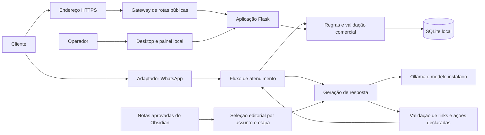
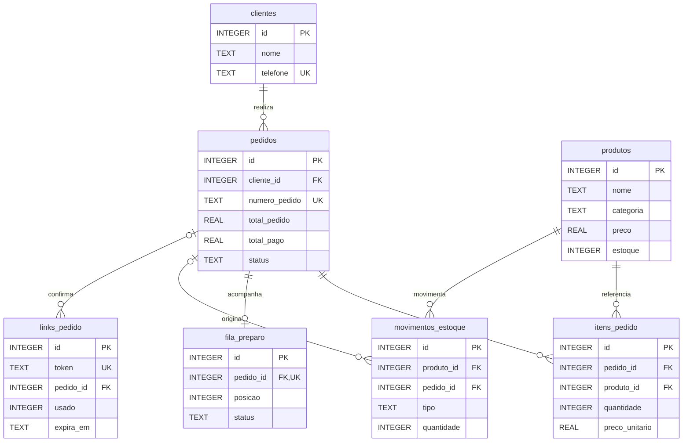

# Arquitetura e rastreabilidade

## Visão de componentes



O desenho representa responsabilidades; não é um inventário de todas as chamadas entre módulos. O modo de IA externa é opcional e fica fora da comparação principal. O Graph é uma visualização das notas, não um mecanismo de persistência de pedidos.

## Modelo de dados do núcleo comercial



Representação parcial de `sql/schema.sql` e das migrações em `src/db.py`. O campo de saldo é acrescentado pelas migrações; `NULL` representa item sem controle de unidades. Há outras tabelas de rascunhos, mensagens, operadores e configurações. Relações obrigatórias e opcionais refletem as chaves do núcleo; regras adicionais são verificadas pela aplicação. Valores monetários usam `REAL` no esquema atual, uma limitação a discutir para futura migração a centavos inteiros ou representação decimal sem perda dos dados.

## Confirmação de pedido na conversa

```mermaid
sequenceDiagram
    participant C as Cliente
    participant B as Bot e rascunho
    participant R as Regras de pedidos
    participant D as SQLite
    C->>B: Seleção de itens
    B->>R: Consultar cadastro e conferir variações
    R-->>B: Itens e preços oficiais
    B-->>C: Solicitar nome, recebimento e pagamento
    C->>B: Dados essenciais
    B-->>C: Resumo calculado e solicitação de confirmação
    C->>B: Confirmação explícita
    B->>R: Confirmar rascunho
    R->>D: Transação com conferência de preço, saldo e repetição
    alt Pedido válido
        D-->>R: Pedido persistido e fila atualizada
        R-->>C: Recibo e número do pedido
    else Item indisponível ou rascunho inválido
        R-->>C: Corrigir seleção; sem confirmação de venda
    end
```

Nesse fluxo a IA não substitui a confirmação determinística. A interface do navegador também valida no servidor antes de gravar.

## Matriz de requisitos

As referências identificam arquivos e funções existentes. A evidência de aprovação depende da execução da versão escolhida. A matriz cobre o recorte do TCC, não todos os recursos do produto.

| ID | Requisito e critério verificável | Implementação | Teste de referência |
| --- | --- | --- | --- |
| RF01 | Diferenciar produção e revenda; produção pode vender sem saldo fictício. | `src/perfil_comercio.py`, `src/estoque.py` | `tests/test_perfil_comercio.py::test_producao_pode_ser_pedida_e_cancelada_sem_saldo_ficticio` |
| RF02 | Manter serviço e peça com contagem em um mesmo comércio. | `src/perfil_comercio.py`, `src/estoque.py` | `tests/test_perfil_comercio.py::test_oficina_combina_servico_e_peca_com_contagem` |
| RF03 | Calcular o total com valores do cadastro. | `src/pedidos.py` | `tests/test_pedidos.py::test_criar_pedido_calcula_total_corretamente` |
| RF04 | Confirmar compra pela conversa e atualizar pedido, fila e estoque. | `src/conversa_pedido.py`, `src/bot.py` | `tests/test_conversa_pedido.py::test_compra_chat_sem_tunel_cria_pedido_fila_recibo_e_estoque` |
| RF05 | Impedir duplicação por confirmação repetida ou concorrente. | `src/conversa_pedido.py`, `src/pedidos.py` | `tests/test_conversa_pedido.py::test_repeticao_confirmacao_e_concorrencia_nao_duplicam` |
| RF06 | Reutilização do link de pedido não cria outra compra. | `src/links.py`, `src/pedidos.py` | `tests/test_pedidos.py::test_link_de_pedido_e_de_uso_unico` |
| RF07 | Selecionar conhecimento relevante e descartar notas inválidas. | `src/cerebro.py` | `tests/test_cerebro_contexto.py::test_busca_assunto_sem_levar_notas_irrelevantes`, `test_ignora_rascunho_metadados_ambiguos_e_validade_invalida` |
| RF08 | Mudar o segmento preservando edições e isolando o contexto antigo. | `src/padroes_atendimento.py` | `tests/test_padroes_atendimento.py::test_troca_de_segmento_preserva_edicoes_e_isola_categoria` |
| RF09 | Preparar HTTPS antes da sessão e só liberar QR com HTTPS pronto. | `src/conexoes.py`, `src/publicacao.py` | `tests/test_https_automatico.py::test_https_antes_do_servico_integrado_e_uma_unica_inicializacao`, `test_qr_so_disponivel_com_https_pronto` |
| RNF01 | Respostas locais objetivas dispensam inferência. | `src/bot.py`, `src/ia.py` | `tests/test_respostas.py::test_perguntas_objetivas_resolvem_sem_ia` |
| RNF02 | Recusar links de pedido inventados pela IA. | `src/processamento.py`, `src/ia.py` | `tests/test_respostas.py::test_resposta_da_ia_nao_envia_site_inventado` |
| RNF03 | Restringir administração e mutações a sessão e CSRF apropriados. | `src/seguranca.py`, `src/operadores.py` | `tests/test_seguranca_privacidade.py::test_administracao_recusa_rede_e_dns_rebinding`, `test_csrf_na_cozinha_e_origem_cruzada` |
| RNF04 | Exportar dados sem tokens e sem exposição desnecessária na auditoria. | `src/privacidade.py` | `tests/test_seguranca_privacidade.py::test_exportacao_restrita_sem_tokens_e_auditoria_sem_telefone` |
| RNF05 | Manter backups cifrados e portáveis sem credenciais em texto claro. | `src/backups.py` | `tests/test_seguranca_privacidade.py::test_backup_portavel_sem_credenciais_e_sem_texto_claro` |
| RNF06 | Rejeitar entradas HTTP ambíguas e manter controles no gateway. | `src/validacao_http.py`, `src/seguranca.py`, `src/publicacao.py` | `tests/test_owasp.py`, `tests/test_zap.py` |
| RNF07 | Distribuir aplicativo e instalador com integridade verificável. | `DeliveryBot.spec`, `packaging/distribuicao.py`, `desktop.py` | `tests/test_distribuicao.py` e smoke do executável no Actions |
| RNF08 | Explicar o próximo passo e preservar interação na atualização. | `web/static/experiencia.js`, `web/templates/gestao.html` | `tests/test_experiencia.py`, `tests/js/experiencia.test.cjs` |

## Decisões e limites

| Decisão | Motivação | Consequência a discutir |
| --- | --- | --- |
| SQLite local | Persistência sem servidor de banco a instalar. | Concorrência e crescimento precisam de avaliação para cargas maiores. |
| Estoque opcional por item | Separar produtos prontos, encomendas e serviços. | Não há gestão automática de ingredientes ou composição de custos de produção. |
| Inferência local opcional | Permitir geração sem API paga obrigatória. | Exige Ollama, modelo instalado e recursos de hardware; consumo de energia e custo do equipamento permanecem. |
| Notas editoriais aprovadas | Tornar a personalização inspecionável e revogável. | Requer revisão humana; seleção textual pode recuperar conteúdo incompleto ou irrelevante. |
| Gateway público restrito | Expor catálogo e pedidos sem publicar o painel. | Não elimina todas as vulnerabilidades nem os riscos do dispositivo hospedeiro. |
| Túnel temporário | Simplificar demonstração e acesso remoto. | URL pode mudar, rede e provedor podem falhar; disponibilidade contínua não é garantida. |
| Testes em dados fictícios | Reproduzir regressões preservando clientes reais. | Não reproduzem integralmente rede, mensagens e comportamento de pessoas em produção. |
